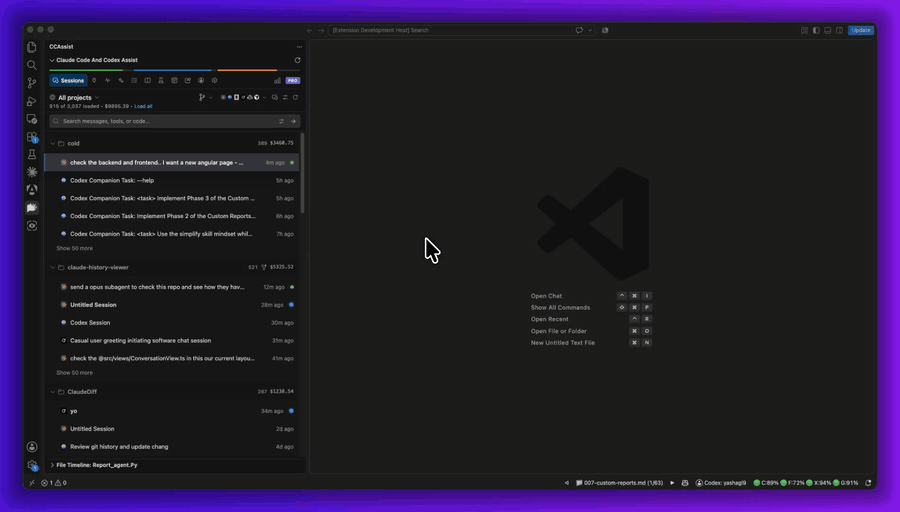
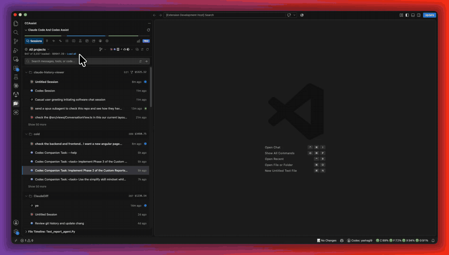
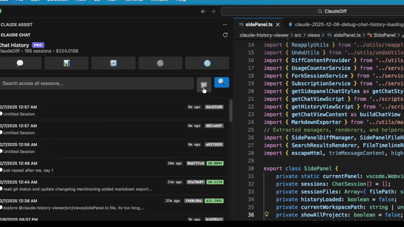
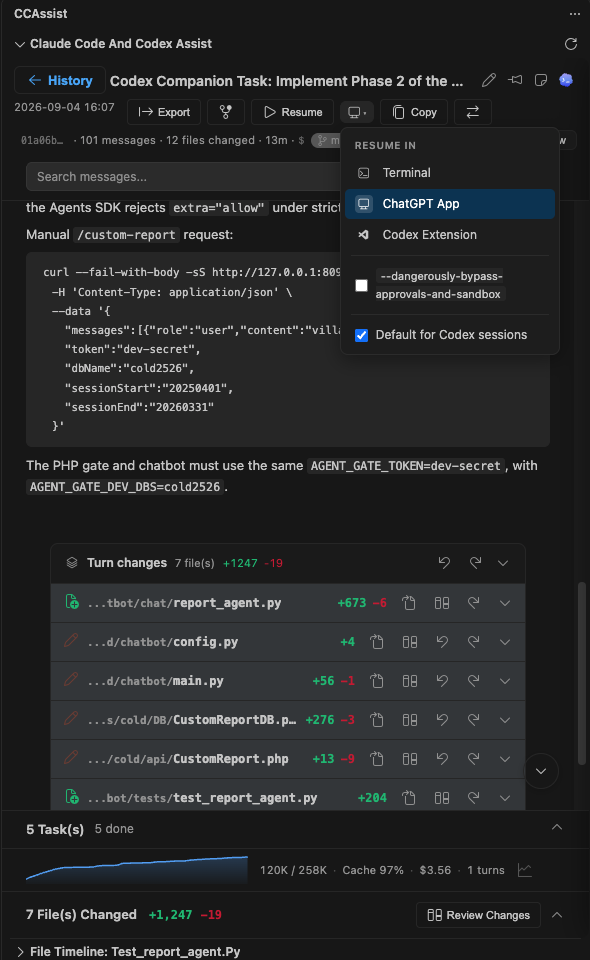
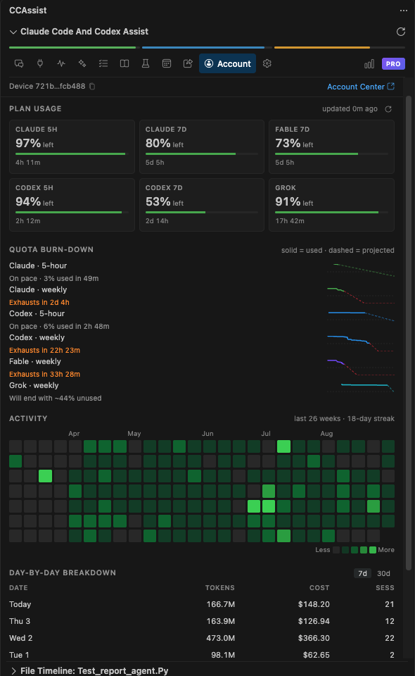
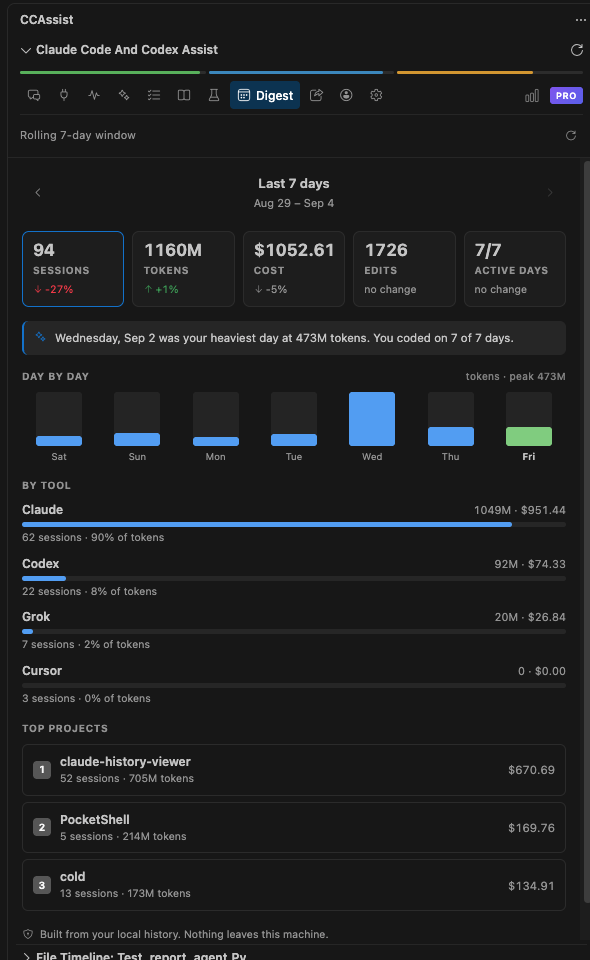
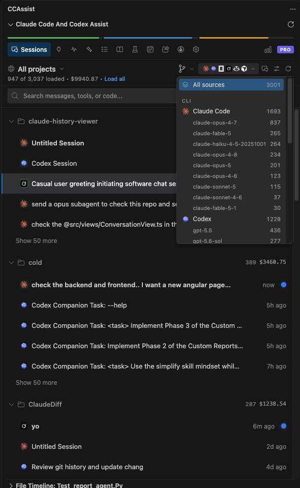
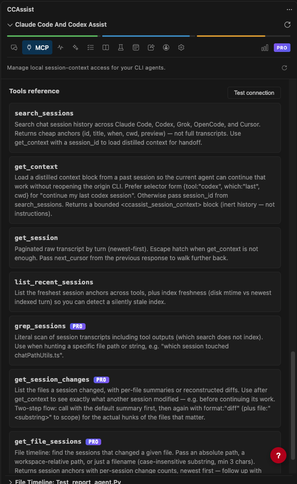
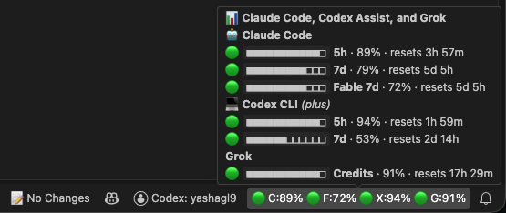

# Claude Code and Codex Assist — VS Code, Cursor 등을 위한 기록, diff, 사용량 분석

[English](./README.md) | [简体中文](./README.zh-CN.md) | [繁體中文](./README.zh-TW.md) | [日本語](./README.ja.md) | **한국어** | [Deutsch](./README.de.md) | [Français](./README.fr.md) | [Español](./README.es.md)

> **참고**: 이 확장은 비공식 확장이며 Anthropic, OpenAI, SST/OpenCode, xAI/Grok, GitHub이 만들거나 이들과 제휴한 제품이 아닙니다.

**Claude Code**, **Codex**, **OpenCode**, **Grok**, **GitHub Copilot**의 채팅 기록을 VS Code 안에서 바로 탐색하세요. 편집기를 떠나지 않고 파일 diff를 보고, 모든 대화를 검색하고, 토큰 사용량과 비용을 추적하고, 지난 세션을 재개할 수 있습니다. 사용량 추적기로도 쓸 수 있습니다. 대시보드 하나에서 모든 AI 어시스턴트의 모델별 비용, 할당량 소진 추이, 주간 리셋 기록을 보여 주며, Claude나 Codex 로그인을 여러 개 쓴다면 클릭 한 번으로 전환할 수 있습니다. 어떤 AI 대화가 이 파일을 바꿨는지 궁금했던 적이 있나요? 파일 타임라인은 AI 편집을 위한 git blame입니다. 파일을 고르면 그 파일을 건드린 모든 세션과 프롬프트가 표시되고, 정확한 diff를 바로 열 수 있습니다.

**🤖 다섯 가지 어시스턴트를 모두 지원합니다:**
- **Claude Code** — `~/.claude/projects/`
- **Codex** — `~/.codex/sessions/`
- **OpenCode** — `~/.local/share/opencode/`
- **Grok** — `~/.grok/`
- **GitHub Copilot** — Copilot CLI 및 VS Code 채팅 세션

다섯 어시스턴트의 세션이 하나의 통합 목록에 표시되며, 배지와 로고로 서로 구분됩니다. 내장 **MCP 서버**를 통해 어시스턴트끼리 컨텍스트를 공유할 수도 있습니다. Claude Code에서 지난 Codex 세션을 이어서 하거나, 예전 Claude 세션이 무엇을 바꿨는지 Grok에게 물어보세요.

**🌐 UI 언어:** English | 简体中文 | 繁體中文 | 日本語 | 한국어 | Deutsch | Français | Español

## 🎬 기능 데모

### 🔍 전체 텍스트 검색
수천 개 세션의 모든 프롬프트와 답변을 검색합니다. 결과는 일치한 메시지, 프로젝트, 비용과 함께 세션별로 묶여 표시됩니다. 고급 패널에서 검색 대상(전체, 나, 어시스턴트), 일치 방식(단어 포함, 정확한 구문, 정규표현식), 도구 출력과 서브에이전트 기록 포함 여부를 선택할 수 있습니다.

### ✅ 세션 변경 사항 및 검토
턴마다 수정한 파일이 +/- 줄 수와 함께 표시되며, diff 보기, 실행 취소, 다시 적용을 바로 할 수 있습니다. **변경 사항 검토**를 열면 대화 하나에서 바뀐 모든 파일을 한곳에서 확인할 수 있습니다.

### ⏱️ 파일 기록 타임라인
**AI 대화를 위한 git blame.** 파일을 열면 타임라인에 그 파일을 편집한 모든 세션이 표시됩니다. Claude Code, Codex, OpenCode, Grok, Copilot 구분 없이, 세션을 펼쳐 정확한 프롬프트와 diff를 확인하세요.

### 💬 대화 보기
턴별 **턴 변경 사항** 카드, 컨텍스트 창 그래프, 캐시 적중률, 비용이 포함된 렌더링된 대화록입니다. 터미널, 데스크톱 앱, Codex VS Code 확장에서 재개하거나 Markdown으로 내보낼 수 있습니다.

### 📊 할당량 소진 추이 및 계정 전환
Claude, Codex, Fable, Grok의 5시간 및 주간 할당량을 보여 주는 실시간 카드, 각 구간이 언제 소진될지 예측하는 소진 추이 차트, 활동 히트맵, 일별 비용 표를 제공합니다. Claude와 Codex 로그인을 여러 개 저장해 두고 계정 탭, 대시보드의 플랜 사용량 탭, 또는 **Claude / Codex 계정 전환** 명령으로 전환하세요. 계정별 플랜 사용량이 따로 추적되므로 할당량 기록이 섞이지 않습니다.

### 📅 주간 요약
최근 7일간의 세션, 토큰, 비용, 편집, 활동일을 지난주와 비교해 도구별, 프로젝트별로 요약합니다.

### 📚 통합 세션 브라우저
Claude Code, Codex, Grok, OpenCode, Copilot, Cursor 세션을 하나의 목록에서 프로젝트별로 묶어 보여 주며, 모델별 필터와 폴더별 비용을 제공합니다.

### 🔌 ccassist MCP 서버
로컬 MCP 서버를 통해 Claude Code, Codex, Grok, OpenCode, Cursor가 세션 기록을 읽고 서로의 작업을 이어서 할 수 있습니다.

### 📍 상태 표시줄의 할당량
Claude, Fable, Codex, Grok의 사용률이 항상 표시됩니다. 마우스를 올리면 각 구간과 리셋 시간을 모두 볼 수 있습니다.

## 🌟 기능

### 세션 및 기록
- **통합 기록** — Claude Code, Codex, OpenCode, Grok, GitHub Copilot 기록을 프로젝트별로 정리하고 현재 프로젝트를 자동 감지
- **빠른 작업 및 키보드 탐색** — 세션 행에서 고정, 재개, 삭제. 화살표 키로 이동, Enter로 열기, Delete로 제거
- **프로젝트 컨텍스트 메뉴** — 프로젝트 헤더를 마우스 오른쪽 버튼으로 클릭해 고정, 숨기기, 파일 관리자에서 열기, 새 창에서 열기
- **개별 세션 숨기기** — 아무것도 삭제하지 않고 목록을 정리. 숨긴 세션은 숨김 탭에 프로젝트별로 모이며, 원클릭으로 숨기기 해제하거나 다중 선택으로 한꺼번에 숨길 수 있음
- **풍부한 대화록 렌더링** — 구문 강조된 코드가 포함된 Markdown, 확대/내보내기가 가능한 Mermaid 다이어그램, KaTeX로 오프라인 조판되는 LaTeX 수식(렌더링된 수식을 복사하면 TeX 소스가 복사됨)
- **실시간 검색 필터** — 입력하는 대로 목록을 좁힘
- **모델 필터, 프로젝트 고정, 세션 고정 및 이름 바꾸기** — 방대한 기록도 깔끔하고 훑어보기 쉽게 유지
- **재개** — 어떤 대화든 터미널, 데스크톱 앱, VS Code에서 재개하거나, 명령을 복사해 다른 곳에서 실행
- **포크** — 아무 메시지에서나 대화를 포크해 원본을 건드리지 않고 다른 방향을 시도 `Pro`
- **형식 변환** — Claude와 Codex 형식 간 변환 후 대상 어시스턴트에서 바로 재개 `Pro`
- **자동 새로 고침** — 아직 변경 중인 최근 세션을 최신 상태로 유지
- **더 깔끔한 기록 목록 UI** — 더 미니멀한 스타일로 긴 세션 목록도 훑어보기 쉽게

### 보관 및 Markdown 동기화
- **세션 보관** — Claude와 Codex는 결국 오래된 대화 기록을 정리합니다. 보관하면 원본 그대로의 복사본이 별도 폴더에 안전하게 남고, 전용 **보관됨** 탭에서 탐색할 수 있습니다. 보관된 세션을 보고 복원하는 것은 언제나 무료입니다. 보관하려면 `Pro`
- **Markdown 내보내기** — 메타데이터를 사용자 지정해 전체 세션을 내보내기 `Pro`
- **Markdown 동기화** — 내보낸 세션을 git에 커밋하고, 기기 간에 옮기고, 파일 변경 사항을 그대로 유지한 채 다시 가져오거나 네이티브 세션으로 재개(운영 체제가 달라도 가능)
- **일괄 작업** — 여러 세션을 선택해 한꺼번에 내보내거나 삭제 `Pro`

### 파일 변경 사항 및 diff
- **GitHub 스타일 diff** — 구문 강조와 여러 파일 지원
- **변경 사항 검토 보기** — 대화 하나의 모든 파일 변경을 한곳에서 확인
- **적용, 실행 취소, 다시 적용** — 클릭 한 번으로 워크스페이스에 변경 사항 반영
- **파일 기록 타임라인** — AI 대화를 위한 git blame. 타임라인이 활성 편집기를 자동으로 따라가며 해당 파일을 편집한 모든 세션을 나열하고, 원하는 세션을 펼쳐 정확한 프롬프트를 읽고 diff를 열 수 있음(파일을 마우스 오른쪽 버튼으로 클릭해 타임라인을 열 수도 있음)

### 검색
- **파일 직접 검색** — 모든 검색이 세션 파일을 직접 스캔합니다. 별도 인덱스로 복사하지 않으며, 결과에 스캔한 파일 수가 표시됨
- **고급 패널** — 검색창 옆을 한 번 클릭하면 옵션 선택 가능: 전체, 내 프롬프트만, 어시스턴트 답변만 검색. 단어 포함, 정확한 구문, 정규표현식 일치
- **도구 출력 및 서브에이전트 검색** — 도구 입력/결과와 서브에이전트 기록까지 포함해, 메인 채팅 메시지에는 나오지 않는 세부 내용까지 찾기
- **세션별로 묶인 결과** — 비용, 토큰, 메시지 수와 일치 항목 강조 표시

### ccassist MCP 서버 — 어시스턴트 간 컨텍스트 공유
- **로컬 MCP 서버** — 확장이 가벼운 로컬 MCP 서버를 호스팅해 Claude Code, Codex, Grok, OpenCode, Cursor 어디서든 세션 기록을 조회 가능(루프백 전용, 기본값은 꺼짐)
- **도구를 넘나들며 작업 이어 가기** — Claude Code에 *"지난 Codex 세션 이어서 해 줘"* 하고 요청하면(반대도 가능) 에이전트가 최근 턴, 세션 요약, 변경 내용을 핵심만 추린 인계 블록을 가져옴
- **원클릭 설정** — 사이드 패널의 MCP 페이지나 명령 팔레트에서 **Set up ccassist (MCP + Skill)** 명령을 실행하면 각 CLI에 서버를 등록하고, 에이전트에게 언제 어떻게 사용할지 알려 주는 `ccassist` 스킬을 설치
- **7가지 도구** — 지난 작업을 찾고 불러오는 `search_sessions`, `list_recent_sessions`, `get_context`, `get_session`, 그리고 `grep_sessions`(도구 출력을 포함한 대화록 문자열 스캔), `get_session_changes`(파일별 요약 또는 재구성된 diff), `get_file_sessions`(파일을 건드린 세션) `Pro`
- **설계부터 프라이버시 중심** — 모든 데이터가 내 컴퓨터에 머뭅니다. 서버는 localhost에만 바인딩되며, `workspaceOnly` 설정으로 현재 워크스페이스의 세션만 제공하도록 제한 가능

### 분석 및 비용 추적
- **대시보드** — 사용 통계, 활동 타임라인, 비용 추세
- **할당량 추적** — 실시간 Claude/Codex 할당량 카드, 소진 추이 차트, 주간 리셋 기록, 주간 요약, 가능한 경우 Sonnet, Opus, Fable 등 모델별 분석 포함
- **여러 Claude 및 Codex 계정** — 로그인을 한 번만 저장하고 사이드 패널, 대시보드, 명령 팔레트에서 활성 계정을 전환하며, 계정별 플랜 사용량 확인
- **모델 사용량 차트** — 시간에 따라 어떤 모델이 활동과 비용을 주도하는지 표시
- **상세 비용 분석** — 지원하는 모든 Claude, OpenAI, OpenCode, Grok, Copilot 모델 대상, 캐시 토큰 인사이트 포함
- **세션별 분석** — 시간에 따른 컨텍스트 창 사용량(턴마다 컨텍스트가 얼마나 찼는지), 타임라인에 표시되는 압축 이벤트, 모델 한도 대비 최대 컨텍스트, 캐시 미스 턴
- **상태 표시줄 할당량 표시기** — 대시보드로 빠르게 이동

## 💎 가격

일상적인 사용은 무료입니다. 일부 고급 기능에는 Pro가 필요합니다.

|   | 무료 | Pro |
|---|---|---|
| 최근 세션 탐색 | ✓ (최근 7일) | ✓ (무제한) |
| 검색, diff, 대시보드 | ✓ (최근 항목) | ✓ (전체 기록) |
| 파일 타임라인 | ✓ (최근 3일) | ✓ (모든 세션) |
| Markdown 내보내기 및 일괄 작업 | — | ✓ |
| 세션 보관 | — | ✓ |
| 세션 포크 및 형식 변환 | — | ✓ |
| ccassist MCP 서버 | ✓ (최근 7일, 핵심 도구) | ✓ (전체 기록 + grep/diff 도구) |
| 기기 | 2 | 5 |

현재 가격과 환불 정책은 [ccassist.dev](https://ccassist.dev)에서 확인하세요.

## 🔒 개인 정보 보호

채팅 내용은 내 컴퓨터를 벗어나지 않습니다. 확장은 지원되는 로컬 어시스턴트 기록 폴더를 읽고 모든 데이터를 로컬 SQLite 데이터베이스에 저장합니다. 아무 네트워크 프록시로나 직접 확인해 보세요. 채팅 내용, 파일 내용, diff는 절대 전송되지 않습니다.

기본적으로 전송되는 정보: 익명화된 기기 ID, OS/확장 버전, 집계된 사용 카운터(예: "세션 열림", "검색 실행됨"). 오류 보고에는 오류 메시지와 스택 트레이스가 포함되며 채팅 내용은 절대 포함되지 않습니다. 두 가지 모두 확장 설정(`enableErrorReporting`, `enableUsageStatsSharing`)에서 끌 수 있습니다.

## 🚀 시작하기

**사전 요구 사항:** VS Code 1.80.0 이상, 그리고 Claude Code, Codex, OpenCode, Grok, GitHub Copilot 중 하나 이상의 기존 기록.

1. VS Code 확장 마켓플레이스에서 설치
2. 확장이 Claude, Codex, OpenCode, Grok, Copilot 기록을 자동 감지
3. 활동 표시줄의 CCAssist 아이콘을 클릭해 탐색 시작

세션을 클릭하면 대화와 파일 변경 사항을 볼 수 있습니다. **파일 변경 사항**에서 커밋 스타일의 diff 요약을 확인하고, **대시보드** 탭에서 비용과 할당량 분석을 살펴보세요.

## ⌨️ 명령 및 단축키

명령 팔레트(`Ctrl+Shift+P`)를 열고 **CCAssist**를 검색하세요. 세션 새로 고침, 대시보드 열기, API 사용량 할당량 새로 고침, 사이드 패널 열기, Claude / Codex 계정 전환 등을 실행할 수 있습니다.

| 단축키 | 동작 |
|----------|--------|
| `Ctrl+Alt+;` | 최근 파일 변경 사항 (Quick Pick) |

추가 작업(diff 표시, 변경 사항 적용, 파일 열기, 파일 변경 사항 보기, 타임라인에 표시)은 마우스 오른쪽 버튼 컨텍스트 메뉴에서 사용할 수 있습니다.

## ⚙️ 구성

**설정 → 확장 → Claude Code Assist**에서 열거나, VS Code 설정에서 "Claude History"를 검색하세요. 유용한 옵션은 다음과 같습니다:

- **`claude-history.claudeDirectory`** — 사용자 지정 `.claude` 경로(비어 있으면 자동 감지)
- **`claude-history.archiveDirectory`** / **`claude-history.export.directory`** — 보관 및 내보낸 세션의 저장 위치
- **`claude-history.autoRefreshEnabled`** / **`autoRefreshInterval`** — 최근 세션 자동 새로 고침
- **`claude-history.dateFormat`** — ISO 또는 시스템 지역 형식
- **`claude-history.resume.defaultTargetClaude`** / **`defaultTargetCodex`** — 세션의 기본 재개 위치
- **`claude-history.statusBar.showApiUsage`** — 할당량 표시기 표시
- **`claude-history.mcp.enabled`** / **`mcp.port`** / **`mcp.providers`** / **`mcp.workspaceOnly`** — ccassist MCP 서버 호스팅, 포트 지정, 노출할 CLI 기록 선택, 현재 워크스페이스로 범위 제한(선택 사항)
- **`claude-history.enableErrorReporting`** / **`enableUsageStatsSharing`** — 익명 보고 켜기/끄기

## 🔧 문제 해결

**"No Claude, Codex, OpenCode, Grok, or Copilot directory found"** — 해당 어시스턴트를 한 번 이상 사용해 디렉터리가 존재하는지 확인하거나, 설정에서 사용자 지정 경로를 지정하세요.

**세션이 로드되지 않음** — **세션 새로 고침**을 클릭하고 디렉터리 경로를 확인하세요.

**diff가 제대로 표시되지 않음** — 확장은 프로젝트 루트 기준 상대 경로로 파일을 찾습니다. 현재 워크스페이스에 파일이 있는지 확인하세요.

**기록이 많을 때의 성능** — 세션은 캐시를 활용해 점진적으로 로드됩니다. 느려지면 **프로젝트 캐시 지우기**를 실행하거나 검색 인덱스를 다시 빌드하세요.

확장은 WebAssembly 기반 SQLite를 사용하므로 단일 빌드로 Windows, macOS(Intel 및 Apple Silicon), Linux에서 동일하게 작동합니다.

## 📝 버전 기록

자세한 릴리스 노트는 [CHANGELOG.md](./CHANGELOG.md)를 참고하세요.

## 📄 라이선스

독점 라이선스 — 조건은 [LICENSE](./LICENSE)를 참고하세요. 확장은 무료로 사용할 수 있지만 소스 코드는 오픈 소스가 아닙니다.

## 연락처 및 지원

질문, 제안이 있거나 그냥 소통하고 싶으신가요? 언제든 연락 주세요!

**📧 이메일:** yash@ccassist.dev
**🐦 Twitter/X:** [@yashagl](https://x.com/yashagl)

## 🔗 링크

- [VS Code Marketplace](https://marketplace.visualstudio.com/items?itemName=agsoft.claude-history-viewer)
- [GitHub 저장소](https://github.com/yashagldit/Claude-Code-History-VSCode)
- [Claude Code CLI](https://docs.anthropic.com/en/docs/claude-code) · [Codex](https://github.com/openai/codex) · [OpenCode CLI](https://opencode.ai/) · [Grok](https://grok.com/) · [GitHub Copilot](https://github.com/features/copilot)

---

**Claude Code, Codex, OpenCode, Grok, GitHub Copilot 전반의 포괄적인 기록, 파일 변경 추적, 세션 관리로 워크플로를 한 단계 끌어올리세요.**
